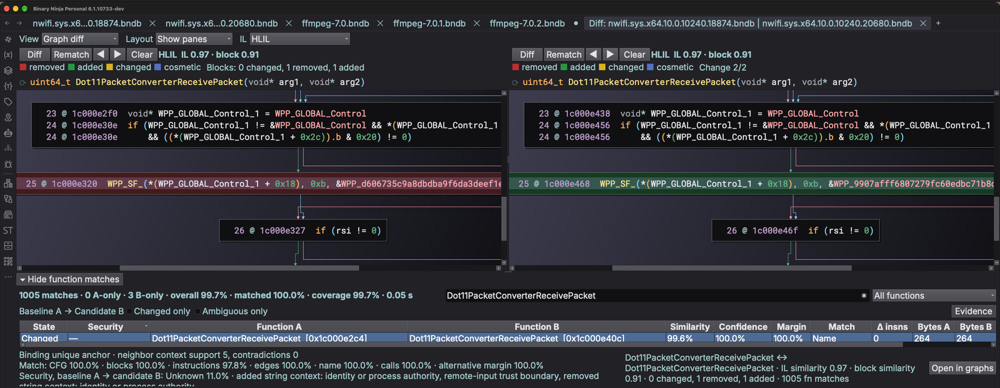
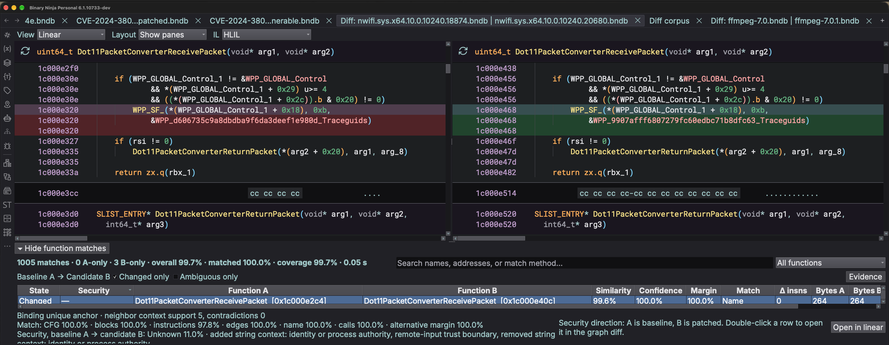
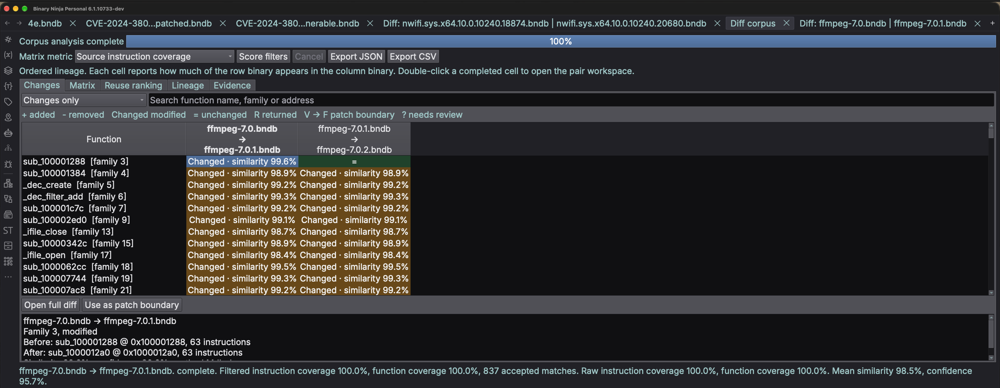

# Binja Diff View

Binja Diff View compares analyzed binaries inside Binary Ninja. It matches
functions across binaries, highlights code changes in synchronized native
views, and provides focused workflows for reviewing a binary pair or a larger
corpus.



The graph diff shows `Dot11PacketConverterReceivePacket` in two builds of
`nwifi.sys`. Side A is the baseline; side B is the candidate.

## What it does

- Matches changed, unchanged, added, and removed functions.
- Shows synchronized Graph or Linear views with block, line, and token
  highlighting.
- Compares Disassembly, LLIL, MLIL, HLIL, and supported language views.
- Reports similarity, confidence, match method, instruction delta, byte count,
  and security-review signals.
- Compares several binaries using a matrix, reuse rankings, function families,
  and ordered release changes.
- Transfers function symbols between matched binaries with preview, conflict
  checks, and undo support.
- Keeps diff overlays in memory and does not modify either BNDB unless you
  explicitly transfer symbols.

## Compare two binaries

1. Open two analyzed binaries in Binary Ninja.
2. Make the baseline (older) binary's tab active; it becomes side A.
3. Select **Plugins → Binja Diff View → Binja Diff: Open Workspace**.
4. Wait for matching to finish.
5. Search, filter, or sort the function table.
6. Double-click a matched row, press Enter, or select **Open in graphs**.

The table highlights each row by state:

- **Changed** (amber): the functions matched, but their contents differ.
- **Matched** (green): ordered instructions, CFG topology, and outgoing-call count agree.
- **Cosmetic** (blue): rendering differs, but the normalized contents agree.
- **A only** (red): the function exists only in the baseline binary.
- **B only** (red): the function exists only in the candidate binary.

Side A is the baseline and side B is the candidate binary. Security review
assumes changes run from A to B.

### Review the diff



- Use **View → Graph diff / Linear** or press Space to switch both panes.
- Use **IL** to change the representation shown and compared in both panes.
- Use **Diff**, the previous and next controls, and **Clear** to inspect the
  overlay. **Diff** in either pane preserves the workspace's A → B direction:
  removed instructions in A stay red and added instructions in B stay green.
- Use **Layout → Hide panes** when you want more room for the function table.
- Sort by similarity, confidence, instruction delta, or byte count to choose
  where to review next. Refresh preserves selection, scrolling, and sorting.
- Combine **Changed only** and **Ambiguous only** with the dropdown filter and
  text search. Right-click a column header to show or hide metric columns.
- Use **Evidence** to inspect whether a pairing is a binding unique anchor and
  how many trusted neighbors support or contradict it.

Both graph panes show the same selected-function scores and compact block-change
counts, including on cache hits. Hover over the counts for the full summary;
the results footer retains the function names and scores.

Inline `«…»` markers identify changed operands in Graph and Linear views,
including when addresses and IL indices are visible. Selected-function scores
measure line similarity: a block can still be marked changed at 100% similarity
when its outgoing control-flow targets differ. **Clear** removes the overlays
and markers from both panes.

Selected-function extraction and comparison run in the background. Use Binary
Ninja's Background Tasks to cancel; cancellation takes effect between stages,
so an extraction or comparison already running may finish first.

Similarity and byte count describe different parts of a change. Byte count is
a useful raw size signal, but compiler layout, alignment, inlining, and code
generation can change it without changing behavior. Treat it as supporting
evidence rather than a verdict. Similarity includes instruction order and operands,
but does not prove semantic equivalence. Confidence is a heuristic method score,
not a calibrated probability. Ambiguous inferred pairs are capped at 50%.

Match schema 25 reserves unique exact/name anchors before assigning uncertain
pairs. Tentative neighborhood correspondences help rank candidates but never
reserve endpoints or establish binding identity. Rare shared strings can nominate
functions outside the size shortlist when their instruction bodies also overlap.
The first comparison of a database requests each function's analysis, because
Binary Ninja restores functions lazily and an unvisited function otherwise
renders without symbols. Older saved extractions and match results are
recomputed under these rules. See the
[matching internals](docs/how-it-works.md) for details.

An **Unmatched · review** row has a possible counterpart supported by a shared
accepted caller and callee. Select the row to see the counterpart and body
similarity. This is a review hint: it does not create a match, change diff scores,
or authorize symbol transfer on its own.

### Combine match filters

Search names, addresses, or match methods, then choose a dropdown filter:

- **Changed matches** or **Cosmetic matches**;
- **Byte size changed**, **Bytes decreased (A > B)**, or **Bytes increased (A < B)**;
- **Low confidence** (below 85%) or **Ambiguous matches** (alternative margin below 1%);
- **Matched**, **Unmatched**, **Unmatched A**, or **Unmatched B**;
- **Match: …** for a method present in the result;
- the security-review filters described below.

Search, the dropdown, **Changed only**, and **Ambiguous only** combine with AND.
For example, select **Match: CallGraph** and check **Changed only** to review
changed call-graph matches. Byte-size, low-confidence, and ambiguity filters
apply to matched pairs; unmatched rows are available through their own filters.
Filtering the table does not rerun matching.

### Use the security filter

The **Security** column ranks changed and added functions for manual review:

- **Security: strong** shows functions with strong direct evidence across the
  security-signal dimensions.
- **Security: relevant** includes Strong and Conflicting results, plus Possible
  results with direct operation evidence and enough supporting context.
- **Bytes decreased (A > B)** and **Bytes increased (A < B)** show size changes
  regardless of security score. **Byte size changed** includes both directions.
- **All functions** shows the complete result, including weaker candidates.

Added and removed instructions contribute directional evidence. Strings, data
references, and non-call code references supply context even inside instruction
operands. Names also supply context, and strings alone cannot produce Strong. Ambiguous
counterpart matches cannot produce Strong either. A removed check is evidence
of a change, not proof that the change fixes a vulnerability. Percentages are
heuristic scores, not probabilities.

These labels prioritize review. They do not establish that a function is
vulnerable or that a change is a security fix.

## Compare a corpus



1. Open at least three analyzed binaries.
2. Select **Plugins → Binja Diff View → Binja Diff: Open Corpus Workspace**.
3. Choose a comparison mode:

   - **Reference vs many** compares one binary with every target.
   - **Ordered lineage** compares releases in order.
   - **All pairs** compares every binary with every other binary.

4. Arrange the binaries in the required order and select **Start**.
5. Choose a matrix metric to inspect coverage, similarity, confidence, or match
   count.
6. Double-click a completed matrix cell to open that pair in the normal diff
   workspace.

Use the corpus tabs to review:

- **Changes** for modifications, introductions, removals, and returns between
  ordered releases.
- **Matrix** for pairwise coverage and matching scores.
- **Reuse ranking** for binaries that share the most code.
- **Lineage** for each function family's presence and state across builds.
- **Evidence** for function-family links and patch-state details.

Changes cells use labels such as **Changed · similarity 98.4%**. That percentage
describes retained similarity, not the amount of code changed.

Use **Score filters** to include or exclude exact matches, thunks, external
stubs, or small functions. Changing a filter updates the matrix, reuse ranking,
and selected matrix cell's details immediately. The details distinguish filtered
metrics from raw coverage.

To classify patch state, select two occurrences from one family. The dialog
shows the assumed vulnerable/fixed direction and lets you swap it before the
signature is created. Added and removed patch blocks count as directional
evidence, including the confirmed absence of a guard or bypass block.
Saved patch signatures from older versions must be recreated after this update;
the current comparison detects outgoing CFG changes and preserves meaningful
variable identities and numeric suffixes. Older signatures and their saved
classifications are discarded when loading a corpus.

Corpus results can be exported as JSON or CSV. JSON binary records include
function and instruction totals from successful pair snapshots. These are raw
totals, independent of score filters, and are not added together when a binary
participates in several comparisons. If a binary changes after a corpus run,
open a new corpus workspace so the results reflect the current analysis.

## Transfer symbols

1. Select one or more matched function rows.
2. Open the context menu and choose the transfer direction.
3. Review the preview and any naming conflicts.
4. Apply the transfer, then save the target BNDB if you want the names to
   persist.

Existing meaningful names are preserved unless you explicitly allow them to
be overwritten. Each applied batch is a single Binary Ninja undo operation.

To associate unmatched functions, select exactly one **A only** row and one
**B only** row, then use the unmatched-pair action before transferring the
symbol.

## Settings

Find these under **Settings → Binja Diff View**:

| Setting | Default | Effect |
| --- | --- | --- |
| `binjaDiffView.blockMatchThreshold` | `0.5` | Minimum IL line similarity for two basic blocks to pair in the overlay. Lower values pair more blocks; higher values mark more blocks added or removed. |
| `binjaDiffView.colorblindPalette` | off | Use a colorblind-safe overlay palette (vermillion, blue, yellow, grey) instead of red, green, amber, and blue. Applies to new diffs. |
| `binjaDiffView.symbolPortMinConfidence` | `0.9` | Minimum match confidence for the bulk "port all visible symbols" actions. Explicitly selected rows are not filtered. |

## Caches and environment variables

Clean, fully analyzed binaries and BNDBs keep their extractions, function
matches, and corpus settings in an on-disk cache, so reopening an unchanged
pair is instant. Raw binaries are also keyed by the effective analysis
settings, so changing a setting recomputes their results. The
cache lives in `binja_diff_view/` under Binary Ninja's cache directory, for
example `~/Library/Caches/Vector 35/Binary Ninja/binja_diff_view` on macOS. It
holds `extractions/`, `matches/`, and `corpora/`. To clear it, quit Binary
Ninja and delete that directory; results are recomputed on the next diff.

Set these before launching Binary Ninja:

| Variable | Default | Effect |
| --- | --- | --- |
| `BINJA_DIFF_DISK_CACHE_MB` | `4096` | Byte budget for cached extractions and matches (512-file limit). `0` bypasses disk reads and writes. |
| `BINJA_DIFF_CACHE_ROOT` | Binary Ninja's cache directory | Alternative root for the whole on-disk cache: extractions, matches, and corpus settings. |
| `BINJA_DIFF_SNAPSHOT_CACHE_MB` | `512` | In-memory budget for extracted binaries and prepared matching features. `0` disables retention. |
| `BINJA_DIFF_PAIR_CACHE_MB` | `256` | In-memory budget for whole-pair match results. `0` disables retention. |
| `BINJA_DIFF_ENGINE_PATH` | unset | Load the Rust engine from this path before the bundled copy. |

## Build and install

The plugin requires CMake 3.15 or newer, a C++20 compiler, Rust with Cargo, and
the Qt 6 version used by your Binary Ninja installation.

Configure CMake with the paths for your Binary Ninja installation and Qt SDK,
then build and install:

```sh
cmake -S . -B build -DCMAKE_BUILD_TYPE=Release \
  -DBN_INSTALL_DIR="/path/to/Binary Ninja" \
  -DBINJA_DIFF_QT_ROOT="/path/to/Qt"
cmake --build build
cmake --install build
```

On macOS, both automatic live refresh and explicit installation stage each
signed dylib and rename it into place. Do not overwrite a loaded dylib in place:
dyld can reject cached pages even when the file passes an on-disk signature
check.

On Windows and Linux, also provide an exact compatible Binary Ninja API
checkout with `-DBN_API_PATH=/path/to/binaryninja-api`. Restart Binary Ninja
after installing or rebuilding the native plugin.

If Binary Ninja reports **“built for an outdated UI ABI”** after an application
update, reconfigure, rebuild, and reinstall against that updated application.
On macOS, CMake selects the API tag from the application's version unless an
API path or tag is explicitly pinned; update any explicit override too. The UI
ABI and Qt version must match as well as the core ABI. Restart Binary Ninja to
load the replacement library.

For matching internals, see [How Binja Diff View works](docs/how-it-works.md).
For the symbol workflow and safeguards, see
[Symbol porting](docs/symbol-porting.md).
For development checks and desktop acceptance tests, see
[Testing](docs/testing.md).
Earlier schema notes and validation measurements are kept in
[Schema and validation history](docs/history.md).
